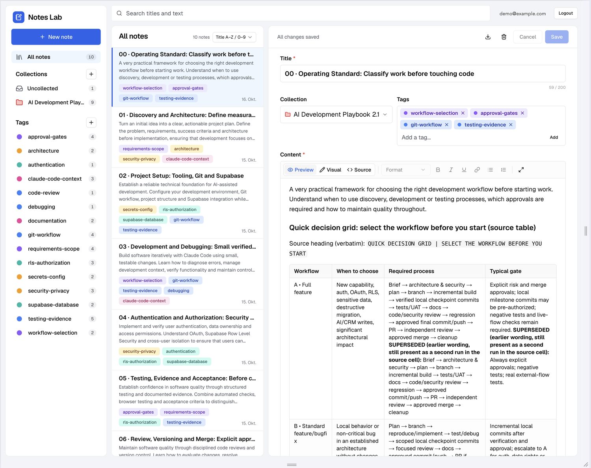
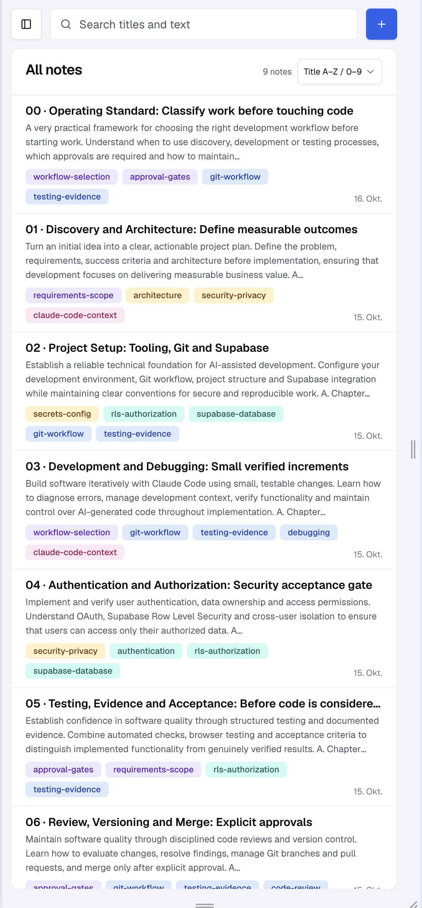
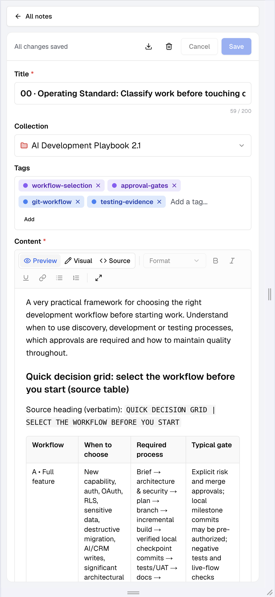
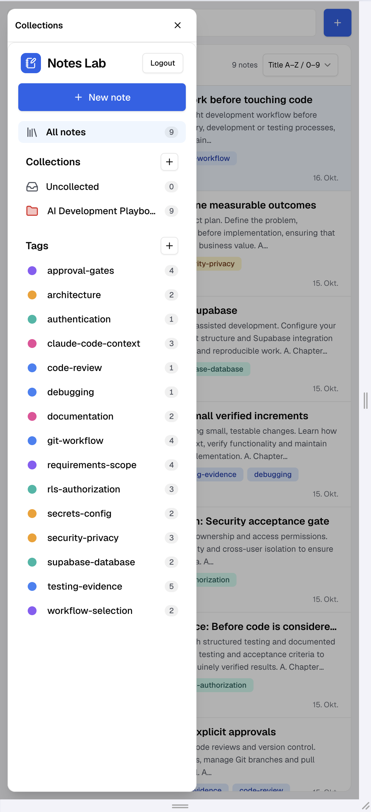

# Notes Lab

Notes Lab is a modern, full-stack notes application designed to capture, organize and retrieve knowledge efficiently.

It combines rich-text and Markdown editing, collections, tags, search and flexible sorting in a clean, responsive interface. Notes are stored in Supabase and protected through authentication and user-specific access controls.

Whether you are documenting projects, collecting research or maintaining a personal knowledge base, Notes Lab keeps information organized and easy to find. It runs locally against your own Supabase project; there is no public deployment.

## Screenshots

### Desktop workspace



### Mobile experience

| Notes list | Note editor | Collections and tags |
|:---:|:---:|:---:|
|  |  |  |

## Features

### Writing & editing
- **Three content modes**: Visual editing for supported Markdown, direct Markdown source editing, and a read-only formatted Preview:
  - **Visual**: a rich-text editor built on [Tiptap](https://tiptap.dev) with a formatting toolbar (headings, bold, italic, underline, links, bulleted and numbered lists) for editing supported content directly.
  - **Source**: the raw Markdown, for full control over syntax and for complex documents.
  - **Preview**: a read-only, formatted view of the Markdown: headings, lists, tables, quotes, code blocks, links and more. Fenced code blocks, such as prompts, have a Copy button, and wide tables scroll sideways.
- **Markdown export**: download the saved note as a `.md` file.
- **Safe editing**: an explicit Save, a Cancel that restores the saved text, and a confirmation before unsaved changes are lost (switching notes, browser Back, closing the tab).
- Notes are stored as Markdown in the database, so what you save is what you get back after a reload.

### Organization & discovery
- **Collections** group notes; **coloured tags** label them (several per note).
- **Search** across titles and note text, combined with **collection and tag filters** (a note must carry every selected tag).
- **Sorting** by title (A–Z or Z–A, with natural number order so chapter `02` comes before `10`) or by last modified (newest or oldest first). Sorting works together with search and filters, and the chosen order is remembered in your browser.
- **Compact previews**: each note card shows up to 30 words in at most 3 lines.

### Authentication & privacy
- Sign in with **email and password** or with **Google**; register yourself with **email confirmation**; reset a forgotten password by **email**.
- The notes area is a private route that is checked on the server, and each note, collection and tag belongs to one account. Row Level Security in the database means other users cannot read or change your data.

### Responsive user experience
- A calm three-column desktop workspace (navigation, note list, editor) with consistent typography and spacing, restrained colour and compact note cards, so attention stays on the content.
- A collapsible sidebar at tablet widths, and on phones separate list and editor screens with a Back button and a collections drawer.
- Touch-friendly controls, labelled buttons, and a drawer that traps keyboard focus, closes with Escape and returns focus.

## Tech stack

| Technology | Role |
|---|---|
| Next.js (App Router), React 19, TypeScript | application, server-side route checks, UI |
| Tailwind CSS, shadcn/ui, Radix UI | styling and accessible components |
| Tiptap (`@tiptap/react`, `starter-kit`, `markdown`, `extension-underline`) | rich-text editor and Markdown conversion |
| Supabase PostgreSQL | notes, collections, tags |
| Supabase Auth (`@supabase/ssr`, `@supabase/supabase-js`) | email/password, Google, sessions |
| Row Level Security | per-user access to every row |

## Getting started

**Prerequisites:** Node.js 20.9 or newer, npm, and a Supabase project (free tier is enough).

```bash
git clone https://github.com/marcbecker1974/notes-lab.git
cd notes-lab
npm install
cp .env.example .env.local   # then fill in the two values below
npm run dev
```

Open **http://127.0.0.1:3000** (use `127.0.0.1`, not `localhost`: the dev server, the auth cookies and the redirect settings all use it). After starting the application, sign in or create an account to access your private Notes Lab workspace. `npm run build`, `npm run start` and `npm run lint` are also available.

| Variable | Value (Supabase dashboard → Project Settings → API) |
|---|---|
| `NEXT_PUBLIC_SUPABASE_URL` | `https://<your-project-ref>.supabase.co` |
| `NEXT_PUBLIC_SUPABASE_PUBLISHABLE_KEY` | the project's publishable key |

Only the publishable key is used. Never add a service-role or secret key to this project.

**Supabase dashboard configuration** (done once; the repository does not recreate it):
- **Authentication → URL Configuration:** Site URL `http://127.0.0.1:3000`, and the redirect URLs your sign-up and password-reset emails return to (for example `http://127.0.0.1:3000/**` for local work).
- **Authentication → Providers:** email/password is available by default (decide whether "Confirm email" is required). For Google sign-in, enable the Google provider with your own OAuth client ID and secret, entered only in the Supabase dashboard.
- **Email:** confirmation and reset emails are sent by Supabase and are subject to its email limits.

**Existing project or a new one?** The app runs as-is against a Supabase project that already has the tables, policies and grants. The repository contains the SQL migration history in `supabase/migrations/`, but installing it on a fresh database has not been fully verified (see [Known limitations](#known-limitations)).

## Database & security

Four tables in the `public` schema, all with Row Level Security enabled:

| Table | Holds | Belongs to |
|---|---|---|
| `notes` | title, Markdown body, optional collection, timestamps | a user (`user_id`) |
| `collections` | name, colour | a user (`user_id`) |
| `tags` | name, colour | a user (`user_id`) |
| `note_tags` | links between notes and tags (many-to-many) | no owner column: checked through its note and its tag |

Supabase Auth identifies the signed-in user. In the database, `user_id` defaults to `auth.uid()` (the id of the user making the request), so the app never sends an owner. Owner-only policies compare `auth.uid()` with `user_id`; a note can only be placed in the user's own collection and a tag link only joins the user's own note and tag; the anonymous role has no access. See `supabase/migrations/20261015130030_enforce_owner_access.sql`.

**What is stored where:** notes, collections, tags and their links are stored in Supabase. The selected sort order is a local interface preference kept in the browser's `localStorage` (`notes-lab:note-sort`); it contains no note content. No note content is intentionally kept in `localStorage` or `sessionStorage`.

More detail: [`docs/ARCHITECTURE.md`](docs/ARCHITECTURE.md).

## Testing

| Command | Covers |
|---|---|
| `npm run test:auth` | route protection rules, redirects, sign-up and recovery paths, Markdown export |
| `npm run test:editor` | Markdown conversion, visual-editor safety guard, Preview, note previews, search |
| `npm run test:list` | previews, natural and date sorting, sorting with search and filters, saved preference |
| `npm run test:mobile` | list/editor screens, Back with unsaved changes, drawer focus, desktop layout rules |
| `npm run test:rls` | live two-account RLS tests (`--dry-run` is offline; `--run` writes disposable rows and needs test-account credentials in a git-ignored `.env.test.local`) |
| `npx tsc --noEmit`, `npm run lint`, `npm run build` | type check, ESLint, production build |

The offline suites, the type check, ESLint and the production build passed on the current code; the live `test:rls` run (two accounts, cross-user access and anonymous access denied) is a recorded result from before the later interface features, which changed no schema or authentication code, and was not repeated for this README. Sign-in, protected routes, persistence, the editor modes and the mobile and desktop layouts were also accepted in manual browser testing by the project owner, and each feature pull request had an independent AI-assisted code review. Details and findings are in [`REFLECTION.md`](REFLECTION.md).

## Known limitations

- Complex Markdown (tables, images, task lists, raw HTML, YAML front matter) cannot be edited safely in the Visual editor. Such notes open in Preview and are edited in Source mode.
- Notes Lab is built for local use; it has not been deployed publicly. Image uploads are not implemented.
- A fresh-database install from `supabase/migrations/` is unverified and has a known unresolved issue: earlier migrations create demo records without an owner, while the final ownership migration refuses to proceed when unowned records remain. Those records must be removed first.
- There is no browser-automation suite; layout and touch behaviour were checked manually.
- On a phone, browser Back with unsaved changes asks first, but after Save or Discard it leaves the page rather than returning to the list.

## Development & course context

Notes Lab was developed and extended as a **Turing College Sprint 2** project, selected option **"Continue with the notes app"**. The starter kit provided the Supabase and Next.js base and the standard auth pages; the Mid-Sprint work built the notes data model, the three-column interface, colour-coded collections and tags, and Google sign-in; Sprint 2 added per-user data isolation with RLS, the editor, Preview, sorting and the mobile layout. Features were built on feature branches and merged through pull requests.

### Optional tasks implemented

| Optional task | Implementation | Evidence |
|---|---|---|
| **Export to Markdown** | Downloads the saved note as `<title>.md`: the title as a heading, then the Markdown body unchanged. Built in Sprint 2 (`lib/note-markdown.ts`, `components/notes/download-markdown.ts`). | Own feature branch, merged in [PR #9](https://github.com/marcbecker1974/notes-lab/pull/9); export checks in `test:auth` and `test:editor` |
| **Password-reset email flow** | Starter-kit flow, improved during development: `/auth/forgot-password` calls `resetPasswordForEmail()`, the emailed link opens `/auth/update-password` (`updateUser()`), and success continues to `/notes`. | Redirect handling in [PR #6](https://github.com/marcbecker1974/notes-lab/pull/6), covered by `test:auth`; owner-verified, demonstrable live |
| **Self-service sign-up** | Starter-kit registration, extended during development: `/auth/sign-up` calls `signUp()`, and the confirmation link returns through a server-side callback (`app/auth/callback/route.ts`) into `/notes`, with clear errors for expired links. | Callback in [PR #5](https://github.com/marcbecker1974/notes-lab/pull/5), changes in PR #6; covered by `test:auth`; owner-verified, demonstrable live |
| **Minimalist design** | A three-column workspace, a consistent palette and component system, coloured collections and tags, compact cards, and responsive tablet and phone layouts with mobile navigation and editing. Built over Mid-Sprint and Sprint 2. | Mid-Sprint [#2](https://github.com/marcbecker1974/notes-lab/pull/2), [#3](https://github.com/marcbecker1974/notes-lab/pull/3), [#4](https://github.com/marcbecker1974/notes-lab/pull/4); Sprint 2 [#10](https://github.com/marcbecker1974/notes-lab/pull/10) to [#13](https://github.com/marcbecker1974/notes-lab/pull/13); demonstrable on desktop and phone |

### Milestones

| Milestone | Pull request |
|---|---|
| Database and data access | [#1](https://github.com/marcbecker1974/notes-lab/pull/1) |
| Authentication and RLS | [#5](https://github.com/marcbecker1974/notes-lab/pull/5), [#6](https://github.com/marcbecker1974/notes-lab/pull/6), [#8](https://github.com/marcbecker1974/notes-lab/pull/8) |
| Markdown export | [#9](https://github.com/marcbecker1974/notes-lab/pull/9) |
| Rich-text editor | [#10](https://github.com/marcbecker1974/notes-lab/pull/10) |
| Markdown Preview | [#11](https://github.com/marcbecker1974/notes-lab/pull/11) |
| Notes list UX | [#12](https://github.com/marcbecker1974/notes-lab/pull/12) |
| Mobile UX | [#13](https://github.com/marcbecker1974/notes-lab/pull/13) |

All merged pull requests: https://github.com/marcbecker1974/notes-lab/pulls?q=is%3Apr+is%3Amerged

### Review evidence

The optional tasks above are documented in this README. The ownership of every row is shown live in the Supabase SQL editor during the review call (two test accounts, their authentication user ids and the matching `user_id` values in `notes`, and the isolation between them). Project records: [`docs/PROJECT_BRIEF.md`](docs/PROJECT_BRIEF.md), [`docs/ARCHITECTURE.md`](docs/ARCHITECTURE.md), [`REFLECTION.md`](REFLECTION.md).
